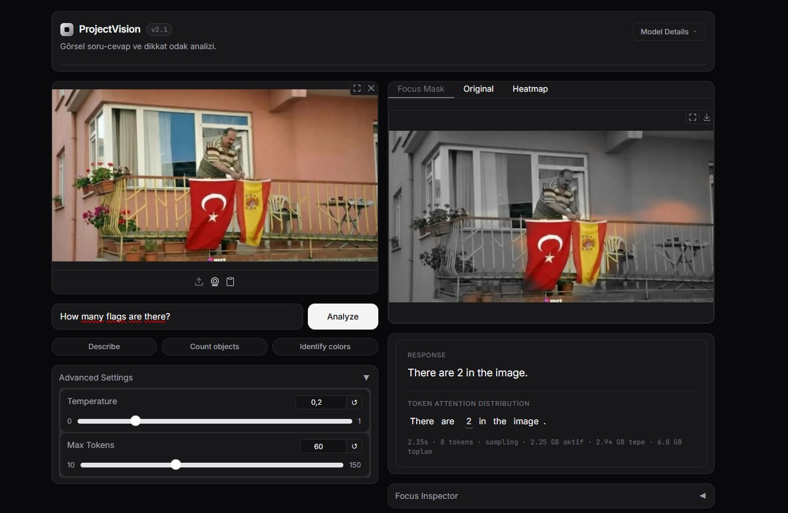
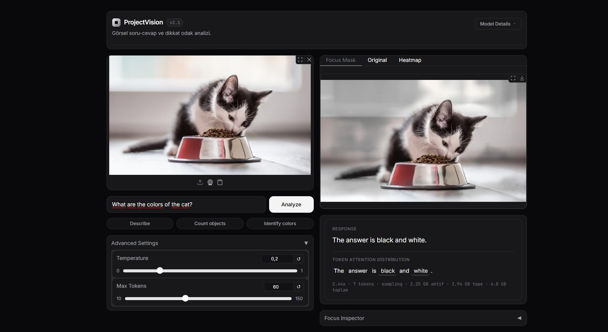
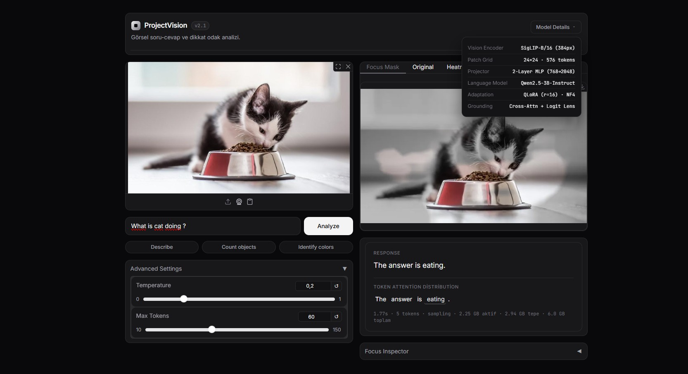
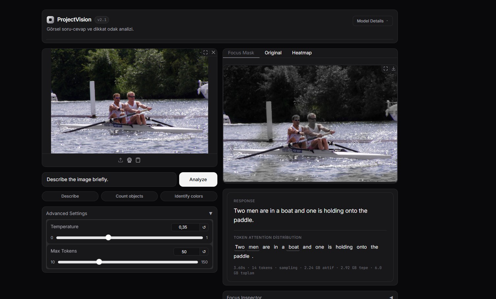
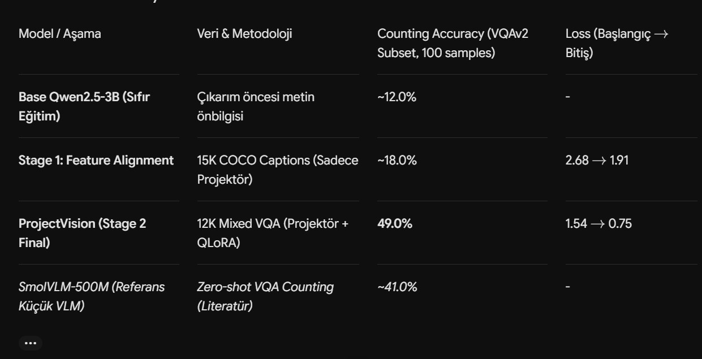

<div align="center">

# ProjectVision v2.1
### Explainable Multimodal Vision-Language Model (VLM) & Minimalist AI Studio

[](README.md)
[](LICENSE)
[](https://www.python.org/)
[-18181b?style=flat-square&logo=pytorch&logoColor=ee4c2c)](https://pytorch.org/)
[](https://huggingface.co/)
[](https://github.com/bitsandbytes-foundation/bitsandbytes)
[](#7-donanım-ve-vram-optimizasyonu-6-gb-gpu-koruması)

*"Built an end-to-end multimodal pipeline integrating frozen SigLIP vision backbone with 4-bit Qwen2.5-3B via a custom-trained MLP projector and targeted QLoRA adapters."*

**ProjectVision v2.1**, dondurulmuş (frozen) **SigLIP** görsel kodlayıcı omurgasını, özel olarak eğitilmiş 2 katmanlı bir **MLP projektör** ve hedefli **QLoRA** adaptörleri aracılığıyla 4-bit **Qwen2.5-3B-Instruct** dil modeliyle bütünleştiren uçtan uca çok modlu (multimodal) bir **Görsel-Dil Modeli (VLM)** boru hattı ve modelin karar verirken görüntünün hangi piksellerine odaklandığını gerçek zamanlı olarak görselleştiren **Açıklanabilir Yapay Zeka (XAI)** web stüdyosudur.

</div>

---

## 1. Arayüz ve Canlı XAI Örnekleri (`assets/`)

**ProjectVision v2.1** arayüzü; **Linear, Vercel ve Apple UI** tasarım ilkeleri doğrultusunda `#09090b` (Zinc-950) zemin, `#18181b` (Zinc-900) kart katmanları, ince yarı-şeffaf kenarlıklar ve **Inter + JetBrains Mono** tipografisiyle tasarlanmıştır. Model bir soruyu yanıtlarken odaklandığı bölgeleri **orijinal renklerinde** bırakır, dikkat etmediği arka planı ise **siyah-beyaz (grayscale)** formata çevirir.

### Örnek 1 — Nesne Sayma ve Keskin Görsel Odaklama (`flags.jpg`)
> **Soru:** *"How many flags are there?"*  
> **Yanıt:** `There are 2 in the image.` — Odak token'ı (`2`) üretilirken model arka plandaki binayı ve balkonu tamamen siyah-beyaza düşürerek yalnızca **iki bayrağı** renkli bırakmıştır.



---

### Örnek 2 — Renk Tanıma ve Semantik Token Dağılımı (`cat1.jpg`)
> **Soru:** *"What are the colors of the cat?"*  
> **Yanıt:** `The answer is black and white.` — **Token Attention Distribution** panelinde `black` ve `white` anlamlı token'ları otomatik seçilmiş ve odak maskesi doğrudan kedinin gövdesiyle mama kabı çevresinde yoğunlaşmıştır.



---

### Örnek 3 — Eylem Analizi ve Mimari Detay Popover'ı (`cat2.jpg`)
> **Soru:** *"What is cat doing?"*  
> **Yanıt:** `The answer is eating.` — Sağ üst köşedeki **`Model Details`** açılır menüsü, arayüzü kalabalıklaştırmadan tüm teknik mimariyi (`SigLIP-B/16`, `24×24 · 576 tokens`, `2-Layer MLP`, `Qwen2.5-3B-Instruct`, `QLoRA · NF4`) sunar.



---

### Örnek 4 — Sahne Betimleme ve Çoklu Token Sentezi (`kurek1.jpg`)
> **Soru:** *"Describe the image briefly."*  
> **Yanıt:** `Two men are in a boat and one is holding onto the paddle.` — İlk anlamlı token'lar (`Two`, `men`, `boat`) birleştirilerek ağaçlık arka plan sönümlendirilmiş ve su üzerindeki kürekçiler öne çıkarılmıştır.



---

## 2. Model Mimarisi ve İki Aşamalı Eğitim Süreci

**ProjectVision v2.1**, üç ana bileşenin uçtan uca birleştirilmesiyle oluşturulmuştur:

```text
┌──────────────────────────────┐
│   Girdi Görseli (RGB)        │
│   384 × 384 Çözünürlük       │
└──────────────┬───────────────┘
               ▼
┌──────────────────────────────┐
│   1. Görsel Kodlayıcı        │  google/siglip-base-patch16-384 (Dondurulmuş / Frozen)
│   SiglipVisionModel          │  (384 / 16)² = 24 × 24 = 576 görsel yama (patch) token'ı
└──────────────┬───────────────┘  Çıktı boyutu: [B, 576, 768] (bfloat16)
               ▼
┌──────────────────────────────┐
│   2. Vision Projector (MLP)  │  Linear(768 → 2048) → GELU() → Linear(2048 → 2048)
│   models/projector.pt        │  Görsel yamaları dil modelinin gömme uzayına hizalar
└──────────────┬───────────────┘  Çıktı boyutu: [B, 576, 2048] (bfloat16)
               ▼
┌──────────────────────────────┐
│   3. Çok Modlu Dizi Birleşimi│  [System Prefix] ⊕ [576 Image Embeds] ⊕ [User Question + Assistant]
└──────────────┬───────────────┘
               ▼
┌──────────────────────────────┐
│   4. Dil Modeli + QLoRA      │  Qwen/Qwen2.5-3B-Instruct (4-bit NF4, Double Quant)
│   models/qwen_lora/          │  LoRA (r=16, α=32) · Target: q, k, v, o, gate, up, down_proj
└──────────────┬───────────────┘
               ▼
      Metin Yanıtı + [T, 36, 576] Attention & Hidden State Tensörleri
```

### İki Aşamalı Eğitim Stratejisi (`ProjectVisionV3.ipynb`)
1. **Aşama 1 — Feature Alignment (Özellik Hizalama):**
   * `SigLIP` ve `Qwen2.5-3B` tamamen dondurulmuş, yalnızca **Vision Projector (`MLP`)** 15.000 COCO Caption örneği üzerinde (`lr=5e-4`, Cosine Warmup) eğitilerek görsel yamaların LLM uzayına taşınması sağlanmıştır.
2. **Aşama 2 — Visual Instruction Tuning (Görsel Talimat İnce Ayarı):**
   * Karma veri seti (**%40 Sayma / How Many**, **%25 Nesne ve Renk VQAv2**, **%20 COCO Captions**, **%15 LLaVA Instruct** — toplam 12.000 örnek) üzerinde hem **Vision Projector** (`lr=2e-5`) hem de **Qwen2.5 QLoRA adaptörü** (`lr=1e-4`, `r=16`, `lora_alpha=32`) birlikte 2 epoch boyunca eğitilmiştir.

### Korunan Ortak Prompt Şablonu
Eğitim ve çıkarım arasındaki dağılım kaymasını (distribution shift) önlemek için girdi metni iki parçaya ayrılarak tokenize edilir ve tam ortaya `576` görsel gömme (embedding) vektörü yerleştirilir:

```text
<|im_start|>system
You are a helpful assistant that can see images and answer questions directly and concisely.<|im_end|>
<|im_start|>user
[576 ADET IMAGE_EMBEDS TENSÖRÜ]{question}<|im_end|>
<|im_start|>assistant
```

---

## 3. Nicel Değerlendirme ve Sayısal Test Sonuçları (`assets/test_results.jpg`)

Eğitim aşamalarının etkinliğini ölçmek amacıyla, eğitim setinden tamamen ayrılmış (unseen / held-out) **VQAv2 "How Many" (Nesne Sayma)** alt kümesi (100 test örneği) üzerinde nicel doğruluk (**Counting Accuracy**) ve eğitim kaybı (**Loss**) metrikleri kaydedilmiştir:

| Model / Aşama | Veri & Metodoloji | Counting Accuracy (VQAv2 Subset, 100 samples) | Loss (Başlangıç → Bitiş) |
| :--- | :--- | :---: | :---: |
| **Base Qwen2.5-3B (Sıfır Eğitim)** | Çıkarım öncesi metin önbilgisi | `~12.0%` | `-` |
| **Stage 1: Feature Alignment** | 15K COCO Captions (Sadece Projektör) | `~18.0%` | `2.68 → 1.91` |
| **ProjectVision v2.1 (Stage 2 Final)** | 12K Mixed VQA (Projektör + QLoRA) | **`49.0%`** | **`1.54 → 0.75`** |
| *SmolVLM-500M (Referans Küçük VLM)* | *Zero-shot VQA Counting (Literatür)* | `~41.0%` | `-` |



* **Bulguların Analizi:** Yalnızca projektörün eğitildiği **Aşama 1** sonunda model genel sahne betimlemesi yapabilse de nesne sayma doğruluğu `%18.0` seviyesinde kalmıştır. **Aşama 2**'de hedefli QLoRA adaptörleri ve dengeli VQA karışımıyla yapılan ortak eğitim sonucunda kayıp (loss) `0.75` seviyesine inmiş ve sayma doğruluğu **`%49.0`**'a ulaşarak referans küçük VLM sınırını (`~%41.0`) geride bırakmıştır. Ayrıca eğitim sonunda uygulanan **Sıfır Tensör (Körlük / Zero-Tensor Ablation)** testleriyle modelin ezbere metin üretmediği, yanıtlarını doğrudan görsel yama temsiline dayandırdığı doğrulanmıştır.

---

## 4. Açıklanabilir Yapay Zeka (XAI) ve Görsel Odaklama Algoritması

`core/attention.py` modülü, modelin yanıt üretirken görselin hangi bölgesine baktığını **4 aşamalı hibrit bir boru hattı** ile hesaplar:

1. **Cross-Modal Attention Çıkarımı (`output_attentions=True`):**
   * `generate()` sırasında üretilen her $t$ cevap adımı ve her $l \in [0, 35]$ katmanı için son sorgu (query) pozisyonunun `576` görsel anahtar (key) yaması üzerindeki dikkat ağırlıkları yakalanır, tüm dikkat başlıkları (attention heads) ortalanır ve yama ekseninde olasılık dağılımına normalize edilir: $\mathbf{A} \in \mathbb{R}^{T \times 36 \times 576}$.
2. **Anlamlı Token Seçimi & Baseline Oranlaması (Recency / Sink Eliminasyonu):**
   * `"The"`, `"answer"`, `"is"`, `"in"`, `"image"` gibi şablon kelimeler (stopwords) filtrelenerek yalnızca görsel bilgi taşıyan ilk anlamlı token'lar (`black`, `white`, `2`, `eating`, `boat` vb.) seçilir.
   * Nedensel (causal) maskeleme kaynaklı konum yanlılığını ve ViT "attention sink" yamalarını bastırmak için genel bir referans sorgunun dikkat dağılımına göre log-oran ($\log \mathbf{A} - \log \mathbf{A}_{\text{base}}$) hesaplanır.
3. **Contrastive Logit Lens (`output_hidden_states=True`):**
   * Her katmandaki `576` görsel yama temsili, Qwen'in son `RMSNorm` ve `lm_head` (unembedding) matrisi üzerinden geçirilerek hedef cevap kelimesinin logit skoru genel bir görsel kelime dağarcığıyla karşılaştırılır. Hibrit modda normalize edilmiş Cross-Attention oranı ile Logit Lens semantik uyumu birleştirilir.
4. **24×24 Uzamsal Dönüşüm, Bilinear Enterpolasyon ve Alpha Blending:**
   * $576$ boyutlu vektör $24 \times 24$ 2B matrise dönüştürülür, aykırı sink yamaları komşu medyanı ile onarılır (`_inpaint`) ve `torch.nn.functional.interpolate(..., mode="bilinear")` ile orijinal görselin $(H, W)$ boyutuna enterpole edilir.
   * Yumuşak eşikleme (`smoothstep`) maskesi $\alpha \in [0, 1]$ kullanılarak odaklanılan pikseller renkli, arka plan ise siyah-beyaz olacak şekilde harmanlanır:
     $$\text{Output}(x, y) = \alpha(x, y) \cdot \text{RGB}(x, y) + \big(1 - \alpha(x, y)\big) \cdot \text{Grayscale}(x, y)$$

---

## 5. Kullanılan Teknolojiler

| Katman | Teknoloji / Kütüphane | Rolü ve Kullanım Amacı |
| :--- | :--- | :--- |
| **Derin Öğrenme Çatısı** | `PyTorch 2.x` (`CUDA`, `bfloat16`) | Tensör işlemleri, `torch.inference_mode()` ve `F.interpolate` uzamsal yeniden boyutlandırma |
| **Görsel Kodlayıcı** | `SiglipVisionModel` (`google/siglip-base-patch16-384`) | Görüntüyü $24 \times 24 = 576$ adet 768 boyutlu yama vektörüne kodlama |
| **Büyük Dil Modeli** | `Qwen/Qwen2.5-3B-Instruct` | 36 katmanlı otoregresif dil modeli (`attn_implementation="eager"` ile tam dikkat matrisi erişimi) |
| **Kuantizasyon** | `bitsandbytes` (`NF4`, Double Quantization) | 3B parametreli dil modelini 4-bit hassasiyette ~2.0 GB VRAM'e sığdırma |
| **Adaptör İnce Ayarı** | `PEFT` (`LoraConfig`, `PeftModel`) | Düşük dereceli (`r=16`, `alpha=32`) QLoRA ağırlıklarını taban model üzerine yükleme |
| **Görüntü İşleme** | `Pillow (PIL)` & `NumPy` | Grayscale dönüşümü, Inferno ısı haritası renklendirmesi ve alpha-blending |
| **Web Arayüzü (UI/UX)** | `Gradio 6.x Blocks` + Özel CSS | Minimalist karanlık tema, etkileşimli sekme tuvali ve dinamik token dikkat inceleyici |

---

## 6. Proje Dizin Yapısı

**ProjectVision v2.1**, **Sorumlulukların Ayrılması (Separation of Concerns)** prensibine uygun olarak modüler bir yapıda kurgulanmıştır:

```text
ProjectVisionAPP/
├── app.py                          # Minimalist AI Studio arayüzü (ProjectVision v2.1), özel CSS/HTML ve Gradio event bağlantıları
├── core/
│   ├── __init__.py                 # Core paket tanımı
│   ├── config.py                   # Model kimlikleri, prompt şablonu ve ağırlık dizini çözümleyici
│   ├── model.py                    # VisionProjector (MLP), 4-bit Qwen2.5 + QLoRA, SigLIP yükleme ve VRAM yönetimi
│   ├── attention.py                # Attention/Logit-Lens yakalama, 24x24 haritalama, sink filtreleme ve odak maskeleme
│   └── inference.py                # Gömme (embedding) birleştirme, metin üretimi ve XAI soru-cevap pipeline'ı
├── models/
│   ├── projector.pt                # Eğitilmiş 2 katmanlı Vision Projector ağırlıkları (768 -> 2048 -> 2048)
│   └── qwen_lora/                  # Eğitilmiş QLoRA adaptör ağırlıkları
│       ├── adapter_config.json
│       └── adapter_model.safetensors
├── assets/                         # Uygulama içi ekran görüntüleri, XAI odak maskesi örnekleri ve test sonuçları
│   ├── cat1.jpg
│   ├── cat2.jpg
│   ├── flags.jpg
│   ├── kurek1.jpg
│   └── test_results.jpg
├── ProjectVisionV3.ipynb           # Veri hazırlama, 2 aşamalı eğitim ve değerlendirme (Counting Accuracy) notebook'u
├── requirements.txt                # Temel Python kütüphane bağımlılıkları
├── LICENSE                         # MIT Lisansı
└── README.md                       # Proje dokümantasyonu
```

---

## 7. Donanım ve VRAM Optimizasyonu (6 GB GPU Koruması)

**ProjectVision v2.1**, **6 GB VRAM'e sahip yerel GPU'larda** (örn. NVIDIA RTX 3060 / 4050 Laptop GPU) OOM (Out-Of-Memory) hatası almadan çalışacak şekilde optimize edilmiştir:

* **Yalnızca Görüntü Kulesi Yükleme:** `AutoModel` yerine doğrudan `SiglipVisionModel` kullanılarak SigLIP'in metin kodlayıcısı belleğe hiç alınmaz (~0.4 GB VRAM tasarrufu).
* **Saf `bfloat16` Boru Hattı:** `VisionProjector`, `SigLIP` ve Qwen'in `norm`, `lm_head`, `embed_tokens` katmanları `torch.bfloat16` üzerinde kilitlenerek gereksiz `float32` dönüşümleri engellenir.
* **Anlık Attention İndirgeme:** `generate()` çıktısındaki ham attention tensörleri (`~0.5 GB`) üretildiği anda GPU üzerinde başlık ortalaması alınıp yalnızca `[T, 36, 576]` boyutunda küçük bir CPU dizisine indirgenir.
* **Garantili Bellek Temizliği:** Her çıkarım `torch.inference_mode()` ve `use_cache=True` altında çalışır; `finally` bloğu içinde tüm ara tensörler silinerek `gc.collect()` ve `torch.cuda.empty_cache()` çağrılır.
* **Ölçülen Gerçek VRAM Tüketimi (RTX 4050 6 GB):**
  * **Boşta (Model Yüklü):** `2.23 GB`
  * **Çıkarım + XAI Tepe (Peak) Kullanımı:** `2.92 GB / 6.0 GB`
  * **Çıkarım Sonrası Aktif Kullanım:** `2.24 GB`

---

## 8. Kurulum ve Çalıştırma

### 1. Gereksinimleri Yükleyin
CUDA destekli PyTorch kurulumunun ardından `requirements.txt` içerisindeki temel kütüphaneleri yükleyin:

```bash
pip install torch torchvision --index-url https://download.pytorch.org/whl/cu124
pip install -r requirements.txt
```

### 2. Ağırlık Dosyalarını Doğrulayın
Eğitilmiş ağırlıkların aşağıdaki yollarda bulunduğundan emin olun (`core/config.py` hem `models/` hem de `models/epoch_2/` dizinlerini otomatik olarak tarar veya `VLM_WEIGHTS_DIR` ortam değişkenini kullanır):
* `models/projector.pt`
* `models/qwen_lora/adapter_model.safetensors`
* `models/qwen_lora/adapter_config.json`

### 3. Web Arayüzünü Başlatın

```bash
python app.py
```

Uygulama başladığında tarayıcınızdan **`http://127.0.0.1:7860`** adresine giderek görsellerinizi yükleyebilir, sorularınızı sorabilir ve **Focus Mask / Original / Heatmap** sekmeleri üzerinden modelin dikkat analizini inceleyebilirsiniz.

---

## 9. Limitations & Failure Modes (Sınırlılıklar ve Hata Modları)

* **Heuristic XAI:** Görselleştirme yöntemi, son katman decoder cross-attention ağırlıkları üzerine uygulanan normalize edilmiş uzamsal filtreleme ve enterpolasyon (bilinear interpolation) içeren sezgisel (heuristic) bir yaklaşımdır; mutlak bir nedensellik garantisi sunmaz.
* **Template Overfitting:** Model Aşama 2'de ağırlıklı olarak VQAv2 şablonlarıyla eğitildiği için kısa ve net (*"The answer is..."*, *"There are..."*) kalıplar üretmeye meyillidir. Dağılım dışı (OOD) serbest diyaloglarda zaman zaman Aşama 1'deki genel tasvir (caption) refleksine geri dönebilmektedir.

---

## 10. Lisans

Bu proje **MIT Lisansı** altında lisanslanmıştır — detaylar için [LICENSE](LICENSE) dosyasına göz atabilirsiniz.
